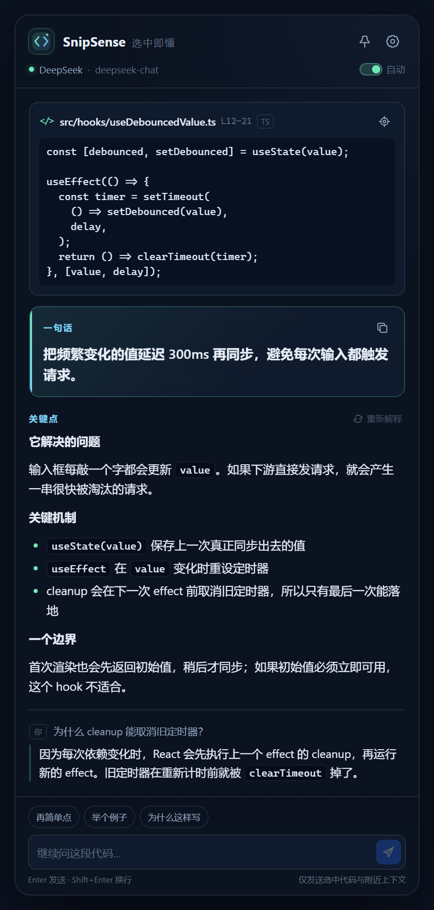
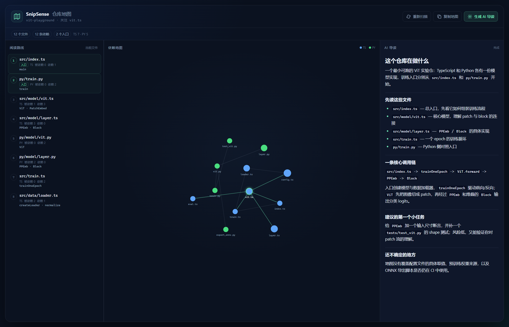

# SnipSense · understand code by selecting it

> Select code. Read it like a dictionary.

[](https://github.com/LuYuan-Zjyy/snipsense/actions/workflows/ci.yml)
[](LICENSE)



SnipSense is a tiny code dictionary for **Cursor** and **VS Code**. Select any snippet, pause for half a second, and it gives you:

- a one-line plain-English gloss at the end of the selection;
- a streaming side-panel card with the key mechanics, edge cases and traps;
- a bounded cross-file view: what it imports, who calls it, and how it is actually used;
- an interactive repo map with entry points, key files and a dependency graph;
- follow-up questions without copying, switching tabs or losing your place.

It is not another chat window. It is the layer you reach for while reading unfamiliar code.

## Why

The usual loop is: select → copy → switch to a browser → open an AI chat → paste → ask → read → switch back → find the line again. The context switch is the expensive part.

Cursor's built-in `Ctrl+L` is great for a deep conversation. SnipSense is for the smaller question: **what is this piece doing?**

## Features

- Auto-explain on selection (550 ms debounce, configurable).
- Inline one-sentence gloss at the selection end.
- Streaming side-panel card, optimised for scanning.
- Cross-file dependency analysis: imports/exports, definition excerpts and reference call sites.
- Token-free Ctrl+click / F12 fallback for functions, classes, imports and aliases.
- Repo map: local dependency scan, PageRank key files, entry points, clickable graph.
- Optional AI reading path grounded in the map; sends paths/symbols/edges, not full source.
- Usage-aware prompt: real arguments, return values, ordering and side effects where evidence exists.
- Follow-up chips: simpler, example, why written this way.
- DeepSeek, OpenAI, SiliconFlow, local Ollama and any OpenAI-compatible endpoint.
- API keys in VS Code `SecretStorage`; no telemetry; cache stores hashes, not source.
- Standard VS Code extension API. No Cursor-private hooks.

## Install

Download `snipsense-0.4.1.vsix` from [Releases](https://github.com/LuYuan-Zjyy/snipsense/releases), then:

```bash
cursor --install-extension snipsense-0.4.1.vsix
# or
code --install-extension snipsense-0.4.1.vsix
```

Reload the window. Run **`SnipSense: 设置模型与 API Key`** from the Command Palette and pick a provider.

Local Ollama:

```bash
ollama pull qwen2.5-coder:7b
ollama serve
```

Select **Ollama（本地）** in SnipSense and test the connection. No API key and no code leaves your machine.

## Use

1. Select code in the editor.
2. Wait 550 ms (or press `Alt+Q`).
3. The inline gloss appears at the end of the selection.
4. Hover it and open the full explanation, or click the SnipSense status-bar item.
5. Use the **Related** section to jump to a dependency or a real call site.
6. `Ctrl+click` an imported function/class name to jump to its definition. If the language server has no answer, SnipSense provides a static fallback with no AI call. `Ctrl+Alt+J` runs the same jump from the keyboard.
7. Press `Ctrl+Alt+M` or run **`SnipSense: 打开仓库地图`** to open the interactive repo map.
8. Ask a follow-up at the bottom of the card.

The card lives in the activity bar. For the best reading layout, drag the view to the Secondary Side Bar on the right.

## Repo map



The map is generated locally and costs no tokens:

- scans code files, resolves imports and builds a directed dependency graph;
- ranks files with PageRank to surface the most important modules;
- detects entry points and proposes a reading order;
- renders a clickable graph (node size = importance, colour = language);
- can be copied as Markdown for onboarding docs.

The optional **AI reading path** sends only paths, symbols and dependency edges — never full source — and runs only when you click it.

## Compared with existing tools

|                                | Cursor `Ctrl+L`   | Copilot Chat    | CodeGlance | SnipSense |
| ------------------------------ | ----------------- | --------------- | ---------- | --------- |
| Automatic on selection         | No                | No              | No         | **Yes**   |
| Inline one-liner               | No                | No              | No         | **Yes**   |
| Side-panel card                | Chat              | Chat            | Yes        | **Yes**   |
| Follow-up on same snippet      | Yes               | Yes             | No         | **Yes**   |
| Cross-file deps / call sites   | Depends on chat   | Depends on chat | No         | **Yes**   |
| Token-free Ctrl+click fallback | Built-in          | Built-in        | No         | **Yes**   |
| Interactive repo map           | No                | No              | No         | **Yes**   |
| DeepSeek                       | Depends on Cursor | No              | No         | **Yes**   |
| Local Ollama                   | Depends on Cursor | No              | No         | **Yes**   |
| Open source                    | No                | No              | MIT        | **MIT**   |

There are close alternatives — [CodeGlance](https://github.com/haarshitgarg/CodeGlance), [Snoop](https://open-vsx.org/extension/wintershin/snoop), [ReasonLine](https://marketplace.visualstudio.com/items?itemName=MauroGarcia.reasonline), [Code Lens AI](https://github.com/xinyulian053-arch/code-lens-ai) — but none had the exact automatic + inline + side-card + DeepSeek/Ollama combination. Hence this project.

## Privacy

By default, SnipSense sends the selected code, a configurable number of surrounding lines, the relative file name, language and line numbers. With multi-file enabled, it also sends a bounded set of definition excerpts from imports actually used by the selection (up to `maxRelatedFiles`) and up to `maxUsages` real reference sites. It never indexes the whole project or `node_modules`, and there is no telemetry or account. Keys are stored in `SecretStorage`; the explanation cache stores the explanation, small graph metadata (including call-site lines) and an irreversible hash. Auto-explain is paused in untrusted workspaces.

The repo map is built locally and makes no AI request. The optional AI reading path sends only the map summary (paths, symbols, edges), not full source.

## Development

```bash
npm install
npm run check            # format + typecheck + lint + 80 tests + build
npm run package          # build a .vsix
npm run preview          # generate docs/preview.html
npm run preview:map      # generate docs/repo-map-preview.html
npm run test:integration # VS Code test host + local mock model, end to end
```

Press `F5` in VS Code/Cursor to launch an Extension Development Host.

## Design notes

The repo map is inspired by [Aider](https://github.com/Aider-AI/aider)'s repo map (tree-sitter + graph ranking), but reimplemented in TypeScript around the existing import graph so the extension needs no Python, tree-sitter runtime, Docker or graph database. [Repomix](https://github.com/yamadashy/repomix) and [code-graph-rag](https://github.com/vitali87/code-graph-rag) were also evaluated; they are excellent at packaging or graph RAG, but heavier than a personal editor plugin needs.

## License

[MIT](LICENSE) © 2026 LuYuan-Zjyy
