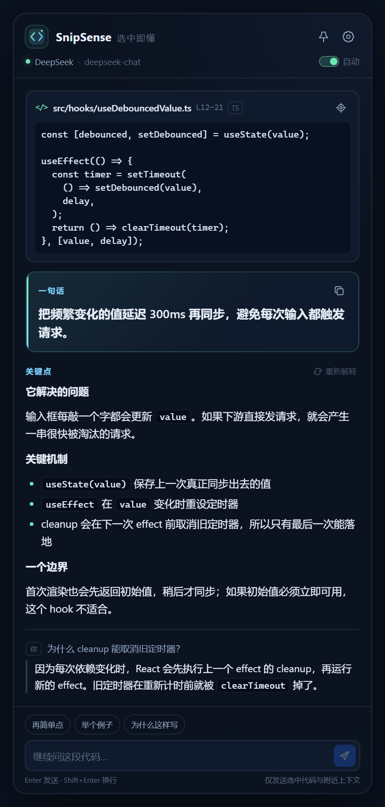

# SnipSense · 选中即懂

> 选中一段代码，像查字典一样读懂它。

[](https://github.com/LuYuan-Zjyy/snipsense/actions/workflows/ci.yml)
[](LICENSE)
[](https://code.visualstudio.com/)
[](https://cursor.com/)



SnipSense 是一个给 **Cursor / VS Code** 用的轻量代码词典。拖选代码，停半秒：

- 选区末尾出现一句“人话”解释；
- 右侧卡片流式展开关键点、边界和坑；
- 顺手梳理它**依赖哪些文件、谁在调用它、真实用法是什么**；
- 不懂就继续追问，不用复制、切浏览器、再粘回来。

它不是另一个聊天窗口，而是读代码时随手可查的一层。

---

## 为什么做它

读陌生项目时，最常见的动作是：

```text
选中代码 → Ctrl+C → 切浏览器 → 打开 AI → Ctrl+V → 提问 → 读答案 → 切回编辑器 → 找回刚才的位置
```

思路就在这来回切换里断了。

Cursor 自带的 `Ctrl+L` / `Cmd+L` 很强，但它仍然是“打开一个对话”。我想要的是更小的动作：**选中就已经在问，眼睛不用离开代码。**

所以做了 SnipSense。

## 它长什么样

| 能力         | 说明                                                                             |
| ------------ | -------------------------------------------------------------------------------- |
| 选中即解释   | 默认停止选择 550ms 后自动请求，可在卡片或设置里关闭                              |
| 行尾一句话   | 在选区末尾显示简短 gloss，不打断代码排版；悬停可打开完整解释                     |
| 侧栏词典卡   | 流式输出“一句话 + 2-4 个关键点”，适合快速扫读                                    |
| 跨文件关联   | 自动找 import/export、定义片段和调用点，卡片列出“它依赖 / 谁在用它”              |
| 无 AI 跳转   | `Ctrl+点击` / `F12` 的本地静态兜底：函数、类、import、别名跨文件跳转，不耗 token |
| 用法说明     | 尽量基于真实调用点讲参数、返回值、调用顺序和副作用                               |
| 继续追问     | `再简单点`、`举个例子`、`为什么这样写`，也可以自己问                             |
| 不绑定模型   | DeepSeek、OpenAI、硅基流动、本地 Ollama、任意 OpenAI 兼容接口                    |
| 手机般的轻量 | 只发选区、附近上下文和有限关联片段，不做全项目索引、不上传遥测                   |
| 开源         | MIT，欢迎改 prompt、加 provider、提 PR                                           |

## 先说明：有这样的插件吗？

我调研了一圈，**接近的不少，但和想要的手感不完全一样**：

- **Cursor 自带 Chat**：选中后 `Ctrl+L` 把代码加入对话，适合深聊；但需要主动开聊，不会在行尾给一句话。参见 [Cursor 快捷键](https://prod.cursor.com/docs/reference/keyboard-shortcuts)。
- **[CodeGlance](https://github.com/haarshitgarg/CodeGlance)**：选中代码后按快捷键，在侧栏用 OpenAI / Anthropic / Copilot 解释；功能方向很像，但需要手动触发，没有行尾提示。
- **[Snoop](https://open-vsx.org/extension/wintershin/snoop)**：偏函数解释的 AI explainer。
- **[ReasonLine](https://marketplace.visualstudio.com/items?itemName=MauroGarcia.reasonline)**、**[Code Lens AI](https://github.com/xinyulian053-arch/code-lens-ai)**：也在做 AI 代码解释，但交互和 provider 取向不同。

结论：**没有找到“选中自动解释 + 行尾一句话 + 侧栏卡片 + 中文/DeepSeek/Ollama”这一套组合**。既然只差这一层，就自己做了 SnipSense。

> 它不是 Cursor 私有插件。SnipSense 只用标准 VS Code Extension API，所以 Cursor、VS Code、以及兼容 VS Code 扩展的编辑器都可以装。

## 快速开始

### 1. 安装

从 [Releases](https://github.com/LuYuan-Zjyy/snipsense/releases) 下载 `snipsense-0.3.0.vsix`，然后：

```bash
# Cursor
cursor --install-extension snipsense-0.3.0.vsix

# VS Code
code --install-extension snipsense-0.3.0.vsix
```

也可以在编辑器的扩展面板里选择 **Install from VSIX**。

安装后重载窗口（`Ctrl+Shift+P` → `Developer: Reload Window`）。

### 2. 连接模型

`Ctrl+Shift+P` → **`SnipSense: 设置模型与 API Key`**

| 服务     | 默认模型                         | 需要 Key | 备注                                 |
| -------- | -------------------------------- | -------- | ------------------------------------ |
| DeepSeek | `deepseek-chat`                  | 是       | 推荐，中文解释自然，价格低           |
| OpenAI   | `gpt-4o-mini`                    | 是       | 通用                                 |
| 硅基流动 | `Qwen/Qwen2.5-Coder-7B-Instruct` | 是       | 国内访问快                           |
| Ollama   | `qwen2.5-coder:7b`               | 否       | 本地运行，代码不出本机               |
| 自定义   | 自填                             | 可选     | 任意 OpenAI 兼容 `/chat/completions` |

DeepSeek Key 在 [这里申请](https://platform.deepseek.com/api_keys)。Key 只写入本机 VS Code 的 `SecretStorage`，不会进入 `settings.json`。

本地 Ollama：

```bash
ollama pull qwen2.5-coder:7b
ollama serve
```

然后在 SnipSense 里选择 **Ollama（本地）**，点“测试连接”。

### 3. 开始读

1. 在编辑器里拖选任意代码，长度不限；
2. 停半秒；
3. 选区末尾出现 `✦ 一句话`；
4. 鼠标悬停那句话，点“查看完整解释”，或点状态栏的 **SnipSense**；
5. 看卡片里的 **关联**：它依赖哪些文件、谁在调用它；点任意一条直接跳转；
6. 在卡片底部继续追问。

也可以：

- 按 `Alt+Q` 手动解释；
- 右键 → **解释选中代码**；
- 命令面板 → **`SnipSense: 解释选中代码`**；
- **`Ctrl+点击`** 调用处的函数名，跨文件跳到定义（语言服务没有结果时由 SnipSense 静态兜底，不耗 token）；
- 也可以按 **`Ctrl+Alt+J`** 或命令面板 **`SnipSense: 跳转到定义（无 AI）`**。

## 和现有工具的区别

|                   | Cursor `Ctrl+L` | Copilot Chat   | CodeGlance | SnipSense |
| ----------------- | --------------- | -------------- | ---------- | --------- |
| 选中后自动解释    | 否              | 否             | 否         | **是**    |
| 行尾一句话        | 否              | 否             | 否         | **是**    |
| 侧栏词典卡        | 聊天            | 聊天           | 是         | **是**    |
| 选中后继续追问    | 是              | 是             | 否         | **是**    |
| 跨文件依赖/调用点 | 取决于对话      | 取决于对话     | 否         | **是**    |
| Ctrl+点击静态兜底 | 内置（视语言）  | 内置（视语言） | 否         | **是**    |
| DeepSeek          | 取决于 Cursor   | 否             | 否         | **是**    |
| 本地 Ollama       | 取决于 Cursor   | 否             | 否         | **是**    |
| 开源              | 否              | 否             | MIT        | **MIT**   |

这不是说谁更好。要重构、要跨文件大改，Cursor Chat / Copilot 更合适；SnipSense 负责的是读代码时最常问的那几个小问题：**这段在干嘛、它靠什么工作、别人怎么用它。**

## 配置

在设置里搜索 `SnipSense`，或直接改 `settings.json`：

```json
{
  "snipsense.provider": "deepseek",
  "snipsense.model": "",
  "snipsense.apiBase": "",
  "snipsense.outputLanguage": "zh-CN",
  "snipsense.explainStyle": "concise",
  "snipsense.autoExplain": true,
  "snipsense.inlineGloss": true,
  "snipsense.debounceMs": 550,
  "snipsense.contextLines": 12,
  "snipsense.maxSelectionChars": 12000,
  "snipsense.maxTokens": 620,
  "snipsense.temperature": 0.2,
  "snipsense.showStatusBar": true,
  "snipsense.multiFile": true,
  "snipsense.maxRelatedFiles": 5,
  "snipsense.maxUsages": 6,
  "snipsense.quickJump": true
}
```

| 配置                | 默认       | 说明                                       |
| ------------------- | ---------- | ------------------------------------------ |
| `provider`          | `deepseek` | 模型服务                                   |
| `model`             | 空         | 留空使用预设                               |
| `apiBase`           | 空         | 可填 `/v1` 或完整 `/chat/completions`      |
| `outputLanguage`    | `zh-CN`    | 解释语言，可切英文                         |
| `explainStyle`      | `concise`  | `concise` 约 120-220 字；`standard` 更完整 |
| `autoExplain`       | `true`     | 选中后自动解释                             |
| `inlineGloss`       | `true`     | 行尾一句话                                 |
| `debounceMs`        | `550`      | 停止选择后等待时间                         |
| `contextLines`      | `12`       | 选区前后各带多少行上下文                   |
| `maxSelectionChars` | `12000`    | 超长选区从中间截断                         |
| `maxTokens`         | `620`      | 单次回复上限                               |
| `temperature`       | `0.2`      | 解释代码建议低温                           |
| `showStatusBar`     | `true`     | 状态栏入口                                 |
| `multiFile`         | `true`     | 分析 import/export、定义和调用点           |
| `maxRelatedFiles`   | `5`        | 最多附带多少个依赖文件片段                 |
| `maxUsages`         | `6`        | 最多附带多少处调用点；`0` 关闭搜索         |
| `quickJump`         | `true`     | Ctrl+点击 / F12 的静态定义兜底，不耗 token |

> `provider`、`apiBase`、`model`、`contextLines` 等会决定代码发往哪里、发多少，因此被设为 **application 级**配置，工作区的 `.vscode/settings.json` 不能偷偷改掉它们。

## 隐私与安全

- 只发送：选中代码、选区前后各 `contextLines` 行、文件名（相对路径）、语言和行号。
- 多文件开启时，额外发送：被选中代码实际用到的 import 对应文件的**有限定义片段**（最多 `maxRelatedFiles` 个），以及最多 `maxUsages` 处真实调用点。
- 不发送：完整项目、无关文件、`node_modules`、终端内容、编辑历史。
- 不接入任何遥测；没有账号体系。
- API Key 存在 VS Code `SecretStorage`，不写入设置文件，不写日志。
- 解释缓存只保存 `gist/detail`、少量关联元数据（含调用行文本）和哈希键，不保存完整文件；缓存键不可逆。
- 多文件分析只在工作区文件内做路径解析，不递归扫描整个项目。
- 未受信任的工作区（Restricted Mode）会暂停自动解释，只有你手动执行解释时才发送。
- 如果代码含密钥、隐私数据，请关闭 `multiFile`、改用本地 Ollama，或不要选中发送。

## 常见问题

**它怎么知道有哪些关联文件？**

SnipSense 解析当前文件的 import/export，解析相对路径和常见别名（TS/JS 的 `@/`、`~/`，Python 的相对模块和“当前目录优先”的绝对导入，Java 的包路径），再用 VS Code 的 Reference Provider 找调用点。只取和选区真正相关的符号，不会整库索引。`ViT.py` 里 `from layer import PPEmb` 会优先找同目录的 `layer.py`，再找工作区根目录和 `src/`。

**为什么关联文件不准？**

动态 import、路径别名、monorepo、语言服务器缺失都可能影响解析。卡片里的“关联”只展示有证据的文件和调用点；模型被要求没有证据就说“未发现调用点”。TS/JS 和 Python 的效果最好。

**它会递归分析整个依赖树吗？**

不会。SnipSense 只做“选中代码这一跳”：直接 import 的定义片段 + 直接调用点，避免把整个项目塞进上下文和账单。多跳依赖可以后续做成可选能力。

**选中后没有自动解释？**

检查 `snipsense.autoExplain` 是否为 `true`；工作区是否处于 Restricted Mode；以及状态栏是否显示“未连接”（需要先配置 Key）。

**Ctrl+点击还是没反应？**

SnipSense 会先让语言服务处理；语言服务没有结果时，才用本地静态解析兜底。如果 Cursor 把 Ctrl+点击占用成了别的操作，按 **`Ctrl+Alt+J`**，或右键选择 **`跳转到定义（无 AI）`**。这个功能不调用模型，不消耗 token。

**行尾没有出现一句话？**

检查 `snipsense.inlineGloss`；如果选区结束位置在屏幕外，先滚动到选区末尾。也可以直接看侧栏卡片或按 `Alt+Q`。

**卡片在哪里？**

左侧活动栏的 SnipSense 图标；或点状态栏右下角的 `SnipSense`；或命令面板 `SnipSense: 打开代码词典`。建议把视图拖到右侧 Secondary Side Bar，读代码时更顺手。

**为什么只显示一句话，没有关键点？**

模型可能只返回了 gist 部分，或流式响应被中断。点“重新解释”，或换一个模型。

**报 404 / 模型不存在？**

检查 `apiBase` 和 `model`。`apiBase` 可以填 `https://host/v1`，SnipSense 会自动补 `/chat/completions`；也可以直接填完整地址。

**Ollama 连接失败？**

确认 `ollama serve` 在运行，模型已 `ollama pull`，并且 `http://127.0.0.1:11434/v1` 可访问。某些 Ollama 版本需要 `OLLAMA_HOST=0.0.0.0` 才能从容器/远程访问。

**会花很多钱吗？**

一次解释通常几百 token；默认只发选区附近上下文，且有缓存。把 `autoExplain` 关掉、只用 `Alt+Q` 可以进一步控制调用。

## 开发

```bash
npm install
npm run check            # 格式 + 类型 + lint + 76 个单元测试 + 构建
npm run dev              # 监听 extension + webview
npm run package          # 生成 .vsix
npm run preview          # 生成 docs/preview.html（截图见 docs/preview.png）
npm run test:integration # 启动 VS Code 测试宿主，用本地 mock 模型跑端到端流程
```

调试：用 VS Code / Cursor 打开仓库，按 `F5` 启动 Extension Development Host。

目录：

```text
src/core/           纯逻辑：prompt、SSE、parser、缓存、endpoint、跨文件图
src/vscode/         控制器、侧栏 Webview、选择捕获、配置、依赖分析
webview/            词典卡片 UI（marked + DOMPurify）
test/               Vitest 单元测试
scripts/            icon / preview 生成
```

欢迎改 prompt、加 provider、做主题适配。提交前跑 `npm run check`。

## Roadmap

- [ ] 解释历史 / 收藏
- [x] Ctrl+点击的本地静态跳转兜底
- [ ] 本地小模型自动路由（简单片段走 Ollama）
- [ ] 代码块语法高亮
- [ ] 英文 UI（当前 UI 中文，解释语言可切英文）
- [ ] Go / Rust 的模块解析增强
- [ ] 团队共享 prompt 预设
- [ ] 发布到 Open VSX

## License

[MIT](LICENSE) © 2026 LuYuan-Zjyy

感谢 [marked](https://github.com/markedjs/marked)、[DOMPurify](https://github.com/cure53/DOMPurify) 和 VS Code Extension API。
